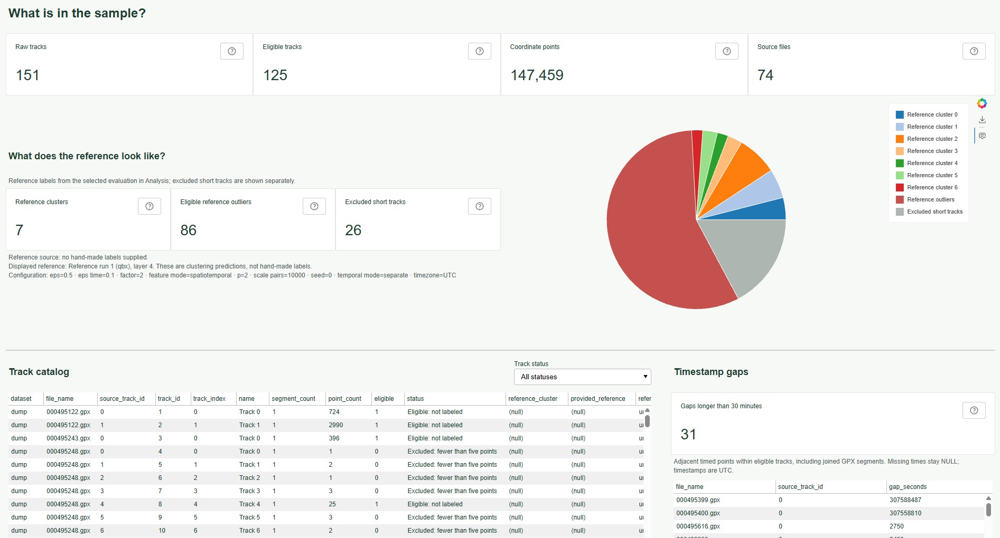
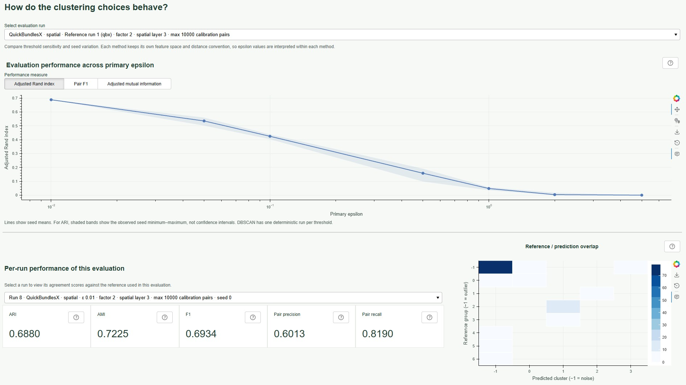

# GPX Trajectory Analytics

[](https://github.com/jRitt869/gpx-track-analytics/actions/workflows/checks.yml)

A data analysis application built around GPS trajectories: audit GPX dataset quality and explore **QuickBundlesX / DBSCAN** evaluation findings in a **Bokeh dashboard**. The workflow makes source records, exclusions, label provenance, parameter choices, and exploratory findings inspectable and repeatable.

The tool is based on an internship application which remains documented and preserved in [`historical/`](historical/README.md). Its core functionality was reused in `track_clusters/`. Later ingestion, SQLite reporting, clustering evaluation, and dashboard tooling live together in the [analytics extension](extensions/analytics/README.md).

## Using the application

The worklow is entirely modular. Each step from data ingestion over evaluation to visualization can be accessed though a standalone entry point:

| Module | Responsibility |
| --- | --- |
| [`load_data.py`](scripts/load_data.py) | Import GPX tracks and optional CSV reference labels into source-specific SQLite databases, individually or in a configured batch. |
| [`get_clusters.py`](scripts/get_clusters.py) | Run DBSCAN or QuickBundlesX on stored tracks and save clustering settings, labels, and colors. |
| [`evaluate.py`](scripts/evaluate.py) | Evaluate one algorithm against hand-made labels or a configured reference run, creating missing clustering results and storing agreement scores. |
| [`run_server.py`](scripts/run_server.py) | Serve the Bokeh dashboard to explore stored tracks, clustering maps, reference statistics, and evaluations. |
| [`start.py`](scripts/start.py) | Ingest configured sources, evaluate both algorithms for supported input modes, and start the dashboard during container setup. |

These scripts are all located in `scripts/`. Invoke ingestion, clustering, and evaluation as `python -m scripts.NAME` from the repository root; add `-h` for descriptions, choices, and defaults. Serve `run_server.py` through `python -m bokeh serve scripts/run_server.py --show`; Bokeh's server options are described by `python -m bokeh serve --help`.

An exemplary workflow looks as follows. From the repository root, run

```bash
python -m pip install -r extensions/analytics/requirements.txt
python -m scripts.load_data single demo_data/dump --database-key dump
python -m scripts.get_clusters outputs/dump.sqlite 0.5 0.1 --spatiotemporal
python -m scripts.get_clusters -q outputs/dump.sqlite 0.5 0.1 --spatiotemporal
python -m scripts.evaluate outputs/dump.sqlite --reference-config scripts/config/reference_qbx.toml
python -m bokeh serve scripts/run_server.py --show
```

At any time, a provided track source corresponds to **one SQLite database** in `outputs/`. This database is used to service all queries for tracks, points, hand-made reference labels, clustering assignments/settings, and evaluation scores. Repeated calls of an entry point on the same dataset lead to changes in the database only when the provided arguments change.

### The data source

The ingestion script reads GPX files within a specified directory, as well as optional reference labels through CSV files. Additional tracks/labels can be appended to the existing catalog using the `load_data.py` script.

Tracks with complete valid timestamps support `--spatiotemporal` clustering. Both algorithms default to separate spatial layers followed by a subcluster layer obtained from a day/week/month temporal subdivision. Adding `--joint` combines space and all three calendar phases in the primary clustering layers, without an extra time layer. `--p` configures the temporal distance and space–time Lp combination; spatial distances remain Euclidean. The [cyclic metric specification](extensions/analytics/README.md#cyclic-temporal-metrics) defines the distances and defaults.

If no reference labels are provided, `evaluate.py` can take an optional reference configuration as ``--reference-config FILE.toml``, which specifies the clustering parameters of a reference run against which the evaluation is performed.

### Sample data and batch ingestion

The repository includes two exemplary data sources in `demo_data/003` and `demo_data/dump`, alongside [`demo_data/003_labels.csv`](demo_data/003_labels.csv), which contains hand-made labels for the tracks in `demo_data/003`. They can be fed into their respective databases `outputs/003.sqlite` and `outputs/dump.sqlite` by running

```bash
python -m scripts.load_data batch
```

By default, this command accesses the file [`extensions/analytics/datasets.toml`](extensions/analytics/datasets.toml), which contains context for the creation of multiple databases. To adjust the input pipeline, this file can be modified, or a different config file is provided using the `--config` argument.

## Navigating the dashboard

Open [http://localhost:5006/run_server](http://localhost:5006/run_server) and select a **Data source** at the top right. The interface consists of four tabs:

- **DBSCAN** and **QuickBundlesX** appear independently when their source database has clustering results. Each contains a run selector, map, layer controls, and track/cluster/outlier counts.
- **Overview** describes the input tracks, eligibility, labels, duplicates, timestamps, gaps, and available results.
- **Analysis** displays only recorded evaluations, with selections identifying algorithm, input mode, and hand-made-label or reference-run baseline. Before evaluation, it contains a disclaimer.

Reload the browser after scripts add sources or new results. Bokeh discovers databases in the repository's fixed `outputs/` directory. Browser ingestion controls are absent.


*The Overview tab for the sample data set in `demo_data/dump`.*


*The Analysis tab for `demo_data/dump`, with evaluations against one of the default reference runs.*

### The track clustering map

The tabs **DBSCAN** and **QuickBundlesX** show maintained clustering results for a selected run, using the map controls and styling in `track_clusters/viewer.py`. The [historical application](historical/README.md) has its own renderer and numerical pipeline under `historical/`. Both can read the same source databases; their clustering results are displayed separately.

The map view consists of:

- Three spatial QuickBundlesX layers and their temporal subdivisions.
- DBSCAN spatial clusters and a temporal subdivision of each cluster.
- Cluster colors, red outliers, and optional hiding of outliers.
- Markers for time gaps longer than 30 minutes, with durations on hover.
- The cluster source, which can be chosen from existing runs in the database.

### Historical application

See the [historical README](historical/README.md) for instructions to run the standalone internship visualization and its preprocessing options.

## Docker

To use the application inside a docker container, change to the root directory and run 

```powershell
docker build -t visualize-clusters:latest .
docker run --rm -p 127.0.0.1:5006:5006 visualize-clusters:latest
```

Open `http://localhost:5006/run_server` after setup completes. First startup takes longer because it creates the databases and computes results. To retain them across containers, use a writable named volume:

```powershell
docker run --rm -p 127.0.0.1:5006:5006 --mount "type=volume,source=path-to-gpx-files,target=/visualize-clusters/outputs" visualize-clusters:latest
```

On each start, `scripts/start.py` gets called to automatically ingest configured sources, run both algorithms for each supported mode, and evaluates the data against the default reference run, which is defined in [`scripts/config/reference_qbx.toml`](scripts/config/reference_qbx.toml) when `supports_time()` is true and in [`reference_qbx_spatial.toml`](scripts/config/reference_qbx_spatial.toml) otherwise. Bokeh starts after this setup succeeds.

For local preparation without a server:

```bash
python -m scripts.start --prepare-only
```

Additional Bokeh options, such as `--allow-websocket-origin HOST:PORT`, are forwarded to the server. To serve already prepared databases without running setup, use `python -m bokeh serve scripts/run_server.py --show`.

## Goals and architecture choices

The tool can be used to investigate questions such as:

- Which tracks are eligible for clustering, and where are labels or timestamps missing?
- How do parameter choices affect cluster counts, outliers, and agreement with a reference?
- How closely do DBSCAN and QuickBundlesX match hand-made labels or a chosen reference run?
- Where do trajectories form spatial groups, and how do those groups split by time?

### Modularity

Ingestion, clustering, evaluation, and visualization are separate steps linked by a persistent SQLite database for each source. Tracks, reference labels, run configurations, and results can be added as needed, making the database a reusable record of the analysis. Moreover, the dashboard can be used to read stored results without rerunning clustering or evaluation. Expensive runs on large datasets can therefore be computed separately and inspected on demand, with only data loading and rendering costs.

This modular structure also provides a basis for integrating additional clustering algorithms and extending the database and dashboard with further analyses. The clustering results are stored and accessed in a general format that allows for compatibility with arbitrary algorithms, including hierarchical ones.

## How the comparison works

1. Parse tracks and mark time gaps longer than 30 minutes.
2. Resample each trajectory to 13 points. DBSCAN and separate-mode QuickBundlesX use spatial arc length and interpolate timestamps onto those positions; joint QuickBundlesX includes timestamps in resampling.
3. For spatiotemporal runs, map the resampled timestamps to calendar phases.
4. Cluster spatial features and optionally subdivide using temporal features, or cluster space and time jointly.
5. Project geometries to Web Mercator for the map and save display tables.

| Detail | QuickBundlesX | DBSCAN |
| --- | --- | --- |
| Spatial-only distance | Average pointwise Euclidean distance, divided by its fitted median | Same mean pointwise Euclidean distance |
| Spatial coordinates | Longitude/latitude with one shared spatial scale | Longitude/latitude with one shared spatial scale |
| Separate temporal mode (default) | Scaled mean pointwise spatial distance, followed by temporal subdivision | Same distance and temporal subdivision |
| Joint temporal mode | Mean pointwise spatial/torus Lp distance with separately calibrated components | Same averaged joint distance |
| Temporal subdivision | Mean pointwise day/week/month torus angular Lp distance | Same averaged torus metric |
| Output | Three primary layers; separate mode adds one time layer | One primary layer; separate mode adds one time layer |

Both temporal modes retain all three calendar cycles and average distances over all 13 corresponding samples. Euclidean/Lp norms apply within each sample. The exponent and joint/separate mode are stored with each spatiotemporal run. QuickBundlesX uses circular centroid features to handle cycle boundaries.

Each primary metric is calibrated using median nonzero distances from reproducibly sampled track pairs. Joint spatial and temporal components are balanced separately for both algorithms; spatial scaling uses one scalar across both coordinates and every sample. Epsilon is measured in these normalized units, so thresholds should be explored for each metric. See [distance calibration](extensions/analytics/README.md#distance-calibration) for the defaults and stored values.

Joint QuickBundlesX's timestamp-inclusive resampling can depend on recording intervals, and GPX segments are joined. The [historical application](historical/README.md) retains its original resampling, weekday/hour sphere encoding, scaling, and metrics.

The [historical README](historical/ARCHIVE_README.md) preserves the original parameter tables. The original scoring protocol is not documented here, and those figures have not been reproduced.

## Later additions: analytics and evaluation

The [analytics extension](extensions/analytics/README.md) contains ingestion, SQLite reporting, clustering and evaluation orchestration, and the Bokeh dashboard. Its [clustering and evaluation section](extensions/analytics/README.md#clustering-and-evaluation) explains reference configurations and scoring conventions. These tools were added after the internship project and leave the historical spatial/time workflow unchanged. Codex was used during the development of the extension.

## License

The code and associated documentation are licensed under the [MIT License](LICENSE).
