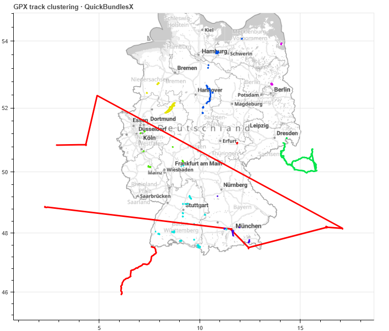

# GPX Track Clustering

An internship project for comparing **QuickBundlesX** and **DBSCAN** on GPS trajectories. It reads timestamped GPX files, clusters routes spatially and temporally, and displays the results on an interactive Bokeh map.

The original GPX preprocessing, clustering integration, temporal encoding, hierarchical color mapping, visualization, and Docker setup were written independently by the project author. This version adds maintenance refactoring, bug fixes, a demo using the supplied GPX tracks, and regression tests. The application retains the original comparison workflow; it is an exploratory research prototype.

The maintained application lives in `track_clusters/`, with its regression tests in `tests/`. The later annotation and evaluation tools, their tests, and saved results are grouped separately under [`extensions/spatial_analysis/`](extensions/spatial_analysis/README.md).

This repository documents previous research work, active development and ongoing support are not planned.



*Current demo using `demo_data/dump`, exported from QuickBundlesX's coarsest spatial layer with `eps = 0.5`, `factor = 2`, and `seed = 0`: 7 clusters and 4 outliers among 125 loaded tracks. Colors indicate algorithm clusters; red tracks are outliers. The interface also provides spatial/time layer selection and visibility controls. The original internship screenshot is retained in the historical documentation.*

## What you can explore

- Three spatial QuickBundlesX layers and their temporal subdivisions.
- DBSCAN spatial clusters and a temporal subdivision of each cluster.
- Cluster colors, red outliers, and optional hiding of outliers.
- Markers for time gaps longer than 30 minutes, with durations on hover.
- Track names and cluster assignments on hover.

Clustering parameters are chosen when preprocessing. The map switches layers and display options; changing parameters requires another preprocessing run.

## Run the included demo

Use **Python 3.12**. The included [`demo_data/dump`](demo_data/README.md) sample contains 74 GPX files and 151 recorded tracks. The application loads 125 tracks with at least five points, skips 26 shorter tracks, and detects 31 gaps longer than 30 minutes. All supplied points have timestamps, so both spatial and temporal layers are available. The GPX files are used unchanged.

Create an environment and install dependencies from the repository root:

```bash
python -m venv .venv
```

Activate it with `source .venv/bin/activate` on Linux/macOS or `.\.venv\Scripts\Activate.ps1` in PowerShell, then run:

```bash
python -m pip install -r requirements.txt
python get_raw_data.py --timezone UTC demo_data/dump 0.5 0.1
bokeh serve run_server.py --show
```

Open [http://localhost:5006/run_server](http://localhost:5006/run_server). The default algorithm is DBSCAN.

At these settings, DBSCAN produces 9 spatial clusters and 47 outliers on the dump sample.

To try QuickBundlesX, stop the server, regenerate the tables, and restart:

```bash
python get_raw_data.py -q --timezone UTC demo_data/dump 0.5 0.1
bokeh serve run_server.py --show
```

These are exploratory display settings. Each algorithm uses its own distance convention, and matching epsilon values do not make their thresholds equivalent. The demo colors come from clustering predictions; the separate [geographic annotations](demo_data/dump/LABELS.md) are used only by the optional spatial evaluator.

### Docker

```bash
docker build -f dockerfile -t visualize-clusters:latest .
```

Mount the included `demo_data/dump` directory. In PowerShell:

```powershell
docker run --rm -p 127.0.0.1:5006:5006 --mount "type=bind,source=$PWD/demo_data/dump,target=/geodata,readonly" visualize-clusters:latest -q --timezone UTC /geodata 0.5 0.1
```

On Linux/macOS:

```bash
docker run --rm -p 127.0.0.1:5006:5006 --mount "type=bind,source=$(pwd)/demo_data/dump,target=/geodata,readonly" visualize-clusters:latest -q --timezone UTC /geodata 0.5 0.1
```

Open the same map URL. The container preprocesses the mounted data, then starts Bokeh. If preprocessing fails, the server does not start. Outputs remain inside the container unless you mount an output directory separately.

## Use your own GPX files

```text
python get_raw_data.py [-q] [--seed N] [--factor F] [--min_s N]
                       [--timezone ZONE] [--output-dir DIRECTORY]
                       path eps eps_time
```

The input directory is scanned in filename order, without recursion. Both `.gpx` and `.GPX` files are accepted. Tracks need at least five points with nonnegative, chronological timestamps. Missing timestamps or invalid coordinates produce a file/track error. Segments within each GPX track are joined, as in the original implementation.

| Argument | Meaning | Default |
| --- | --- | --- |
| `-q` | Use QuickBundlesX | DBSCAN |
| `eps` | Spatial clustering threshold | Required |
| `eps_time` | Temporal clustering threshold | Required |
| `--factor` | QBx thresholds: `[factor² × eps, factor × eps, eps]`; at least 1 | 2 |
| `--seed` | Integer seed for QBx input ordering | 0 |
| `--min_s` / `--min-samples` | DBSCAN spatial `min_samples` | 5 |
| `--timezone` | IANA timezone, e.g. `UTC` or `Europe/Berlin` | Host-local |
| `--output-dir` | Destination for generated tables and run metadata | Current directory |

QBx spatial clusters smaller than five tracks are displayed as outliers. Both temporal layers use a minimum size of three. DBSCAN's spatial minimum can be changed independently.

The generated files are `raw_data` and `raw_data_jumps` (Feather tables), plus `run_metadata.json` recording parameters, timezone, display projection, and track counts. To load a custom output directory, set `CLUSTER_DATA_DIR` before starting Bokeh:

```powershell
$env:CLUSTER_DATA_DIR = "outputs/qbx"
bokeh serve run_server.py --show
```

On Linux/macOS: `CLUSTER_DATA_DIR=outputs/qbx bokeh serve run_server.py --show`.

The basemap uses an external tile service and needs an internet connection. Track data and clustering run locally.

## How the comparison works

1. Parse tracks and mark time gaps longer than 30 minutes.
2. Resample each trajectory to 13 points, including its timestamp coordinate.
3. Encode weekday and hour on a unit sphere; remove timestamps from spatial features.
4. Run spatial clustering, then temporal clustering within each spatial cluster.
5. Project geometries to Web Mercator for the map and save display tables.

| Detail | QuickBundlesX | DBSCAN |
| --- | --- | --- |
| Spatial features | Ordered 13-point longitude/latitude trajectories, padded with zero z | Flattened longitude/latitude samples, standardized per feature |
| Spatial distance | Average pointwise Euclidean distance | Euclidean distance after standardization |
| Spatial threshold units | Coordinate degrees; not metres | Standardized feature space; not metres |
| Temporal features | All 13 encoded weekday/hour samples | First encoded weekday/hour sample |
| Temporal distance | Normalized angular distance over concatenated samples | scikit-learn cosine distance |
| Output | Three spatial layers plus time | One spatial layer plus time |

QBx's temporal adapter preserves all samples and computes `arccos(cosine_similarity) / π`, following DIPY's cosine metric convention while keeping the 13-by-3 arrays required by QBx. The original direct `CosineMetric(IdentityFeature())` input was incompatible with the sequence shape. See [refactoring notes](docs/REFACTORING.md) for changes that affect displayed assignments.

**The algorithms' epsilon values are not directly comparable.** Their spatial normalization and temporal distance conventions differ. Resampling includes timestamps, so sampling positions can depend on recording intervals. The weekday/hour sphere has representational ambiguities, and GPX segments are joined. These historical choices are retained and documented as limitations.

The [historical README](docs/ARCHIVE_README.md) preserves the original parameter tables. The original scoring protocol is not documented here, and those figures have not been reproduced.

## Later additions: optional spatial analysis

The separate [spatial analysis extension](extensions/spatial_analysis/README.md) contains the newly added spatial evaluator, geographic annotation scripts, plotting helpers, tests, and saved results. It has its own dependencies and test suite. These tools were added after the internship project and leave the application's spatial/time workflow unchanged.

```bash
python -m pip install -r extensions/spatial_analysis/requirements.txt
python -m extensions.spatial_analysis.evaluate demo_data/003 demo_data/003_labels.csv --output-dir outputs/evaluation_003
```

The author's original `003` labels remain in `demo_data/003_labels.csv`. The later [dump annotations and review plots](demo_data/dump/LABELS.md) remain alongside the tracks. Evaluation results and methodology are documented in the extension's README.

## Development

```bash
python -m pip install -r requirements-dev.txt
python -m pytest -q
python -m ruff check .
python -m ruff format --check .
python -m pip check
```

These commands run the application's 32 regression tests, covering spatial assignment after QBx shuffling, seeded repeatability, temporal labels, all-outlier cases, GPX validation, time gaps, empty jump tables, Feather round trips, projection, and Bokeh session independence. The extension's 20 tests run separately using the instructions in its README. GitHub Actions reports the application and extension suites as separate jobs on Python 3.12.

| File or directory | Responsibility |
| --- | --- |
| `get_raw_data.py` | Original CLI entry point and public function imports |
| `run_server.py` | Bokeh server entry point |
| `track_clusters/data.py` | GPX loading, resampling, and time encoding |
| `track_clusters/clustering.py` | Algorithm integration and temporal metric adapter |
| `track_clusters/colors.py` | Original hierarchical color scheme |
| `track_clusters/pipeline.py` | Validation, projection, and output tables |
| `track_clusters/viewer.py` | Map, widgets, callbacks, and per-session state |
| `tests/` | Maintenance regression tests for the internship application |
| `extensions/spatial_analysis/` | Later annotation/evaluation tools, dependencies, tests, and saved results |
| `demo_data/dump/` | Timestamped GPX sample used by the application demo; separate annotations remain alongside the tracks |
| `docs/IMPROVEMENTS.md` | Prioritized portfolio and research improvements |
| `docs/REFACTORING.md` | Preservation decisions, fixes, and verification |

The selected `demo_data/003` and `demo_data/dump` samples, their labels, and review artifacts are allowed by Git's ignore rules. Other local GPX data, generated tables, environments, and the existing `temp` working copies remain ignored. Demo datasets and optional extensions are excluded from the application container build. The `temp` files are retained locally for reference.

## License

The code and associated documentation are licensed under the [MIT License](LICENSE).
