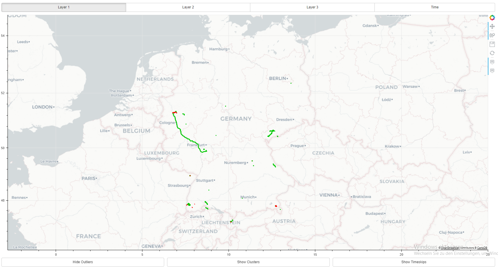

# Docker Webserver Image For Cluster Visualization

The main application consists of a Bokeh webserver which is used to display the output of one of two clustering algorithms:
* **QuickBundlesX**
* **DBSCAN**

For each one of these it is possible to adjust an epsilon parameter for temporal and spacial clustering as well as 
* a *factor* and *seed* parameter for QuickBundlesX:  
*factor*: used to define thresholds for cluster creation for each layer of the output tree, where the thresholds are given by `[factor² * eps, factor * eps, eps]` for layers 1, 2 and 3  
*seed*: by using a seed value it is possible to alter the clustering process in a way that always produces the same output
* a *min_samples* parameter for DBSCAN:  
defines the minimum amount of tracks in a cluster

For both algrithms there exists a variety of features in form of UI elements:
* **Hide Outliers**: showing/hiding the outliers of a clustering result (outliers will be displayed in red)
* **Show Clusters**: showing clusters in different colors/one color
* **Show Timeskips**: showing/hiding timeskips with a duration of > 30 min

Additionally, with QuickBundlesX each layer of the output tree can be inspected individually:

On top of that there is a layer called *Time* which acts as a fourth layer of the QBx algorithm. Clusters for this layer are computed by extracting the weekdays and hours from the timestamps of the tracks, mapping them onto a unit sphere and clustering them using the *cosine metric*.

This layer can also be inspected with DBSCAN.

## Usage

The webserver can be run as a container by forwarding the internal port 5006 and mounting the location of the tracks in the host filesystem as a volume. More specifically, the genaral usage is:  
`docker run -v host_path:container_path -p 5006:5006 visualize-clusters:latest [args]`,

with `args` containing the following:
* -q: whether QuickBundlesX is used or not (dafaults to DBSCAN)
* --factor, --min_s and --seed: clustering parameters, see above (defaults to 2, 5 and 0)
* path: the internal .gpx file directory
* eps, eps_time: the eps parameters, see above

After sarting the webserver, the map can be accessed over http://localhost:5006/run_server.

### Example

`docker run -v e:/germany/gpx-planet-2013-04-09/public/000/003:/geodata -p 5006:5006 visualize_clusters:latest -q --factor 3 /geodata 16`

## Parameter Choice

It is crucial for optimal performance to properly adjust the input parameters in order to obtain the expected number of clusters and percentage of outliers.  
Clustering a subset of 50 users from the germany OSM dump geographically and matching the result against pre labeled data for example yields the following (averaged) results, which may be used to choose an appropriate parameter configuration (*min_s* and *factor* are set to default values):

|method|eps |false_positive|false_negative|
|------|----|--------------|--------------|
|DBSCAN|0.1 |0.187825      |0.114824      |
|QBx   |0.01|0.436272      |0.053995      |
|QBx   |0.05|0.207367      |0.104751      |
|QBx   |0.1 |0.115828      |0.140363      |
|QBx   |0.5 |0.013821      |0.235004      |
|QBx   |1   |0.007254      |0.290349      |
|QBx   |2   |0.001345      |0.338717      |
|QBx   |5   |0.000147      |0.350261      |

It is worth noting that the *eps* value for QuickBundlesX may depend on your data's dimensions since QBx processes the input tracks without prior normalization.

For reference here are some selected parameter choices for temporal clustering with QBx, rated by their (average) produced number of clusters and outliers:

|eps|eps_time|clusters|outliers|
|---|--------|--------|--------|
|0.1|0.01    |12.72   |0.57    |
|0.1|1       |10.25   |0.31    |
|5  |0.01    |14.07   |0.33    |
|5  |1       |3.17    |0.01    |	

