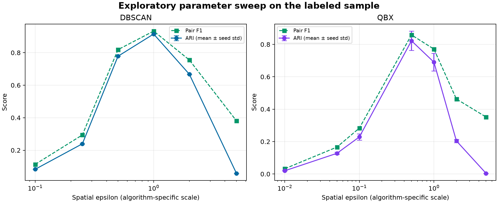
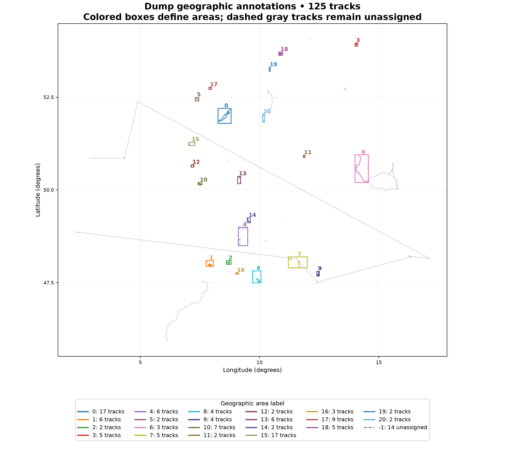

# Spatial analysis extension — later additions

This optional extension was added after the internship project. It contains the new spatial evaluator, geographic annotation tools, plots, and their tests. The maintained internship application remains in `track_clusters/`, with its regression tests in `tests/`. The application does not import this extension, and its runtime requirements do not include the extension's Matplotlib dependency.

| Location | Role and provenance |
| --- | --- |
| `track_clusters/`, `get_raw_data.py`, `run_server.py` | Maintained implementation of the author's original spatial/time clustering application |
| `extensions/spatial_analysis/` | Later annotation and spatial evaluation additions |
| `extensions/spatial_analysis/tests/` | Tests for those later additions |
| `extensions/spatial_analysis/results/003/` | Saved results from the later spatial evaluation |
| `demo_data/003_labels.csv` | The author's original hand-labeled data |
| `demo_data/dump/dump_labels.csv` | Later provisional geographic annotations, stored alongside the tracks |

Run the module commands below from the repository root.

The repository includes the author's hand-labeled `003` sample and a separate `dump` sample with newly created geographic annotations. Evaluation compares **spatial clustering only**. It accepts timestamp-free files without inventing timestamps or running temporal clustering.

## Run an evaluation

Activate the project environment, then run:

```bash
python -m pip install -r extensions/spatial_analysis/requirements.txt
python -m extensions.spatial_analysis.evaluate demo_data/003 demo_data/003_labels.csv --output-dir outputs/evaluation_003
python -m extensions.spatial_analysis.evaluate demo_data/dump demo_data/dump/dump_labels.csv --output-dir outputs/evaluation_dump
```

The dump labels are **provisional agent-created annotations**, independent of algorithm predictions. Review their [area definitions and plots](../../demo_data/dump/LABELS.md) before using them as a research reference. Scores measure agreement with the declared geographic convention.

The default sweep runs DBSCAN once at each of six thresholds and QuickBundlesX at seven thresholds with five seeds: **41 runs**. Both use a spatial minimum size of five; QBx uses its finest spatial layer. Customize the sweep, for example:

```bash
python -m extensions.spatial_analysis.evaluate demo_data/003 demo_data/003_labels.csv --qbx-eps 0.1 0.5 1 --dbscan-eps 0.5 1 2 --seeds 0 1 2 --output-dir outputs/custom
```

Other options are `--algorithms both|qbx|dbscan`, `--factor`, `--min-samples`, and `--qbx-layer 1|2|3`. See `python -m extensions.spatial_analysis.evaluate --help`.

## Labels and matching

CSV labels require `file_name,id,cluster`; extra columns such as an exported index are ignored. The key is a **filename plus the GPX track's `<number>`**, not necessarily its position in the file. For tracks without a number, the loader uses their zero-based position. This matters for files whose track numbers have gaps. Use `--id-source index` only for datasets labeled by list position.

- Nonnegative cluster IDs identify groups; their numeric values have no effect on scores.
- `-1` means an unassigned/outlier track, rather than one group containing all outliers.
- Each eligible track must have exactly one label. Duplicate keys, missing eligible labels, and unknown keys cause an error.
- Tracks with fewer than five points are excluded, matching the application's minimum. Their labels and reasons are saved separately.
- Exact duplicate geometries are retained and listed in an audit.

The author's `003_labels.csv` is retained unchanged. The dump CSV also records excluded short tracks as `-1`; its audit distinguishes them from eligible unassigned tracks.

## Features and scoring

Both algorithms receive trajectories resampled to 13 points by **spatial arc length in longitude/latitude coordinates**, with a zero third coordinate for DIPY. Timestamps and elevation are ignored. GPX segments remain joined. This separate evaluation path leaves the application's timestamp-inclusive resampling and temporal encoding unchanged.

QBx retains average pointwise Euclidean distance in coordinate degrees and seeded input ordering. DBSCAN retains flattened, standardized longitude/latitude samples and Euclidean distance. Their epsilon scales differ and require separate tuning.

Metrics include adjusted Rand index (ARI), adjusted mutual information (AMI), pair precision/recall/F1, pair false-positive/false-negative rates, cluster/outlier counts, outlier detection precision/recall, and clustering runtime. ARI and AMI are invariant to cluster numbering; see [scikit-learn's documentation](https://scikit-learn.org/stable/modules/clustering.html#clustering-performance-evaluation).

For ARI, AMI, and pair metrics, each `-1` becomes a separate singleton in both reference and prediction. Otherwise, unrelated outliers would count as a common cluster. Outlier detection is scored separately because singleton clusters and noise share the same pair partition but have different meanings.

A pair means two distinct tracks, counted once. TP means grouped together in both labelings; FP means together only in the prediction; FN means together only in the reference; TN means separated in both. Pair FPR is `FP/(FP+TN)` and FNR is `FN/(FN+TP)`. Undefined rates are blank; precision/recall/F1 use zero when their denominator is zero.

## Results on the hand-labeled sample

The default sweep scores **267 tracks** from 287 label rows: 20 labeled short tracks are excluded. The reference has five clusters and 86 outliers. There are 25 exact duplicate geometries, retained in scoring.

| Algorithm | Selected epsilon | Mean ARI | ARI seed std | Mean pair F1 |
| --- | --- | --- | --- | --- |
| DBSCAN | 1 | 0.9148 | 0 (deterministic) | 0.9328 |
| QuickBundlesX | 0.5 | 0.8223 | 0.0598 | 0.8585 |

These are **exploratory results on the sample used to select thresholds**, not held-out performance estimates. QBx parameters are selected by mean ARI across seeds. Its comparison plot uses the first requested seed, rather than the most favorable one. DBSCAN's higher ARI here does not establish general superiority.



The [saved report](results/003/REPORT.md), [individual runs](results/003/metrics.csv), [seed aggregates](results/003/summary.csv), [track assignments](results/003/assignments.csv), and [manifest](results/003/manifest.json) record this run. The manifest includes source/label/code SHA-256 checksums, package versions, parameters, and noise policy. New local runs go to the requested output directory without modifying GPX files or input labels.

## Review or revise dump annotations

Annotation cluster are created by **geographic area**, rather than by route shape. Area rectangles were selected from the track inventory without using either algorithm's predictions. Every full-resolution coordinate of an assigned track must fit inside exactly one rectangle. Cross-area, isolated, and ambiguous tracks remain `-1`.

The dump contains 151 tracks: 125 eligible and 26 excluded short tracks. Its 21 areas contain 111 eligible tracks, with 14 eligible tracks left unassigned. Two eligible traces are stationary and eight are exact geometry duplicates; all are retained and flagged. Area sizes vary, so the definitions need review before research claims.



The [regional detail plot](../../demo_data/dump/dump_labels_details.png) shows each area at its own scale. The [audit](../../demo_data/dump/dump_label_audit.csv) records every track's status. The [validation manifest](../../demo_data/dump/dump_label_validation.json) checks complete inventory coverage, unique keys, containment, and at least two eligible tracks per area. Structural checks and visual inspection verify consistency with this rule, rather than independent ground truth.

Edit `demo_data/dump/dump_label_regions.json` to change areas, then regenerate:

```bash
python -m extensions.spatial_analysis.annotate_dump demo_data/dump --regions demo_data/dump/dump_label_regions.json
```

This overwrites the generated dump labels and review artifacts alongside the tracks. It never edits GPX files or the author's `003` labels.

## Extension development

Install and run this extension's suite separately:

```bash
python -m pip install -r extensions/spatial_analysis/requirements-dev.txt
python -m pytest -q extensions/spatial_analysis/tests
```

The extension has 20 tests covering timestamp-free loading, label matching, spatial parity with the application's algorithms, scoring, annotation rules, and output artifacts. The application's 32 regression tests remain under `tests/` and run with `python -m pytest -q`. To run both suites explicitly, use `python -m pytest -q tests extensions/spatial_analysis/tests`. GitHub Actions reports each suite as a separate job.
